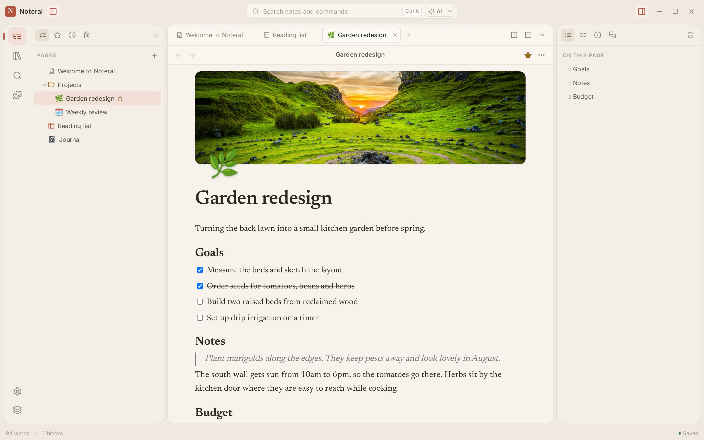
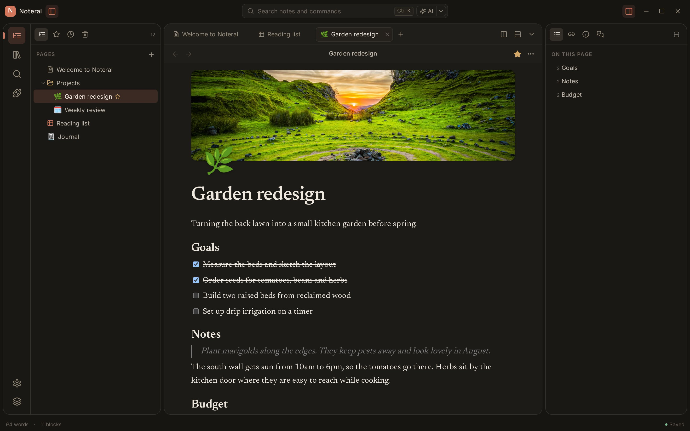

# Noteral

A quiet, local-first notes app for the desktop.



## Features

- **Block editor**: headings, to-dos, quotes, tables, code, images and links between pages.
- **Nested pages**: a page tree, tabs, split panes and favorites.
- **Databases**: tables, boards, calendars, charts and formulas.
- **AI assistant**: ask about a page, rewrite, summarize, or build widgets and themes.
- **Plugins**: a full SDK for commands, menus, popups, status bar widgets and page backgrounds.
- **Local-first**: everything stays on your computer. No account and no sync service.




## Run it

You need Go, Node.js and the [Wails 3](https://v3.wails.io) CLI.

```sh
cd frontend && npm install && cd ..
task dev       # development mode
task build     # desktop build in bin/
```

## Plugins

Plugins are built with the SDK. The SDK, its docs and the community plugin registry live in
[neurh/noteral-plugins](https://github.com/neurh/noteral-plugins).

## Docs

- [Architecture](docs/ARCHITECTURE.md)
- [Databases](docs/databases.md)
- [Assistant](docs/assistant.md)
- [Plugin SDK](docs/PLUGIN_SDK.md)
- [Testing](docs/TESTING.md)
