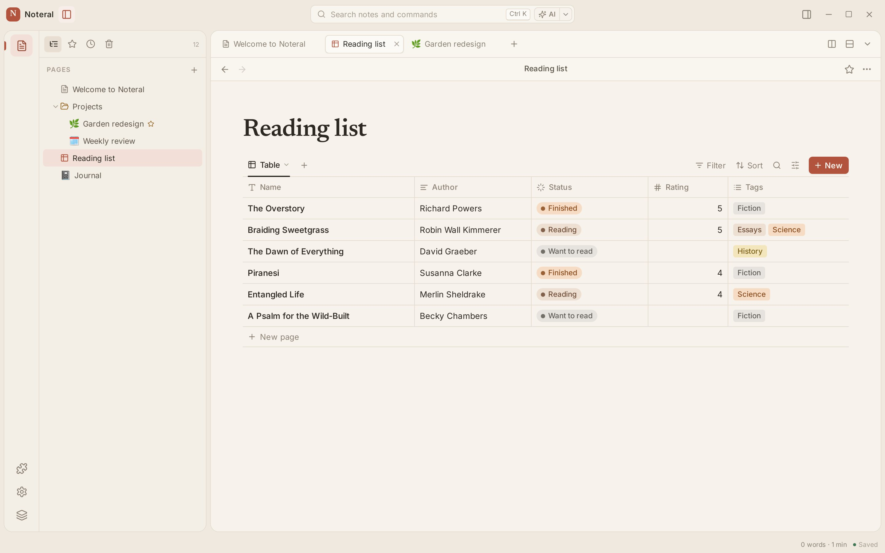
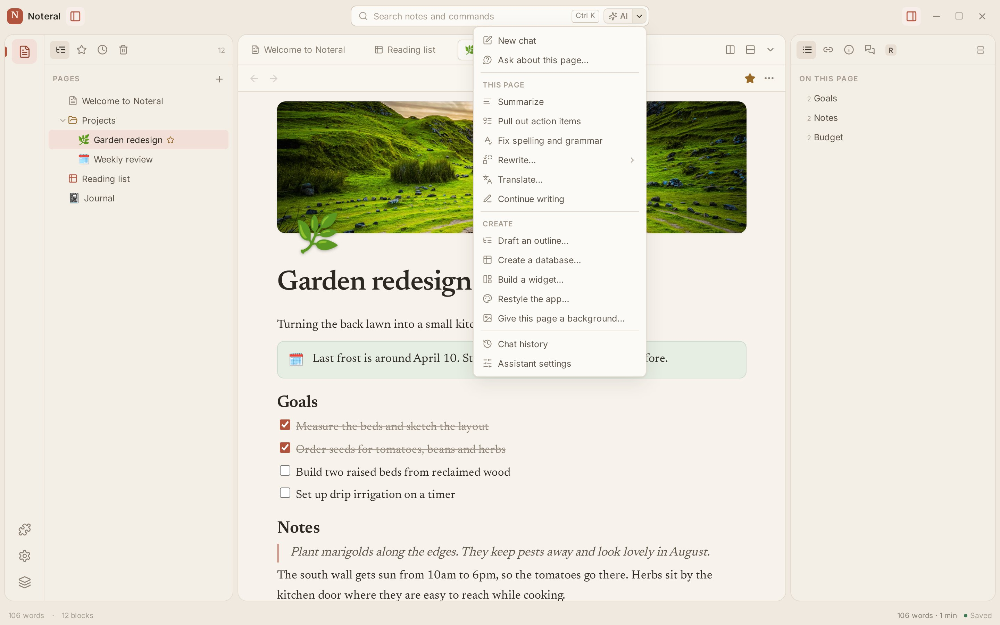
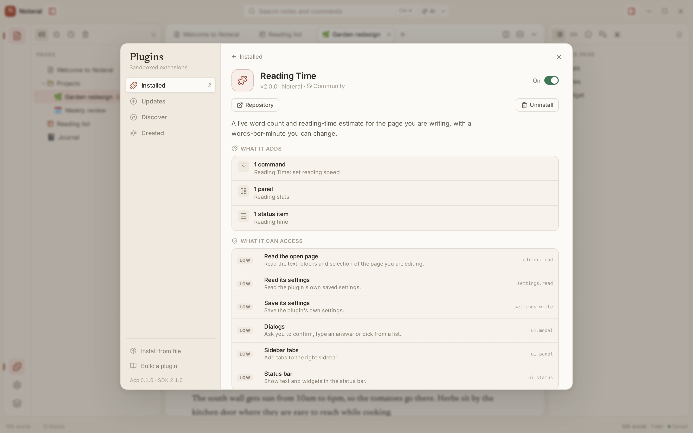

# Noteral

A quiet, local-first notes app for the desktop.


## Features

- **Block editor**: headings, to-dos, quotes, callouts, tables, code, images and links between pages.
- **Nested pages**: a page tree, tabs, split panes and favorites.
- **Databases**: tables, boards, calendars, charts and formulas.
- **AI assistant**: ask about a page, rewrite, summarize, or build widgets and themes.
- **Plugins**: a plugin store and a full SDK for commands, shortcuts, menus, popups, status bar widgets, editing and page backgrounds.
- **Local-first**: everything stays on your computer. No account and no sync service.








## Install

**macOS and Linux**

```sh
curl -fsSL https://github.com/neurh/Noteral/releases/latest/download/install.sh | sh
```

**Windows** (PowerShell)

```powershell
irm https://github.com/neurh/Noteral/releases/latest/download/install.ps1 | iex
```

**npm** (any system with Node.js 18+)

```sh
npm install -g noteral-app
noteral
```

The installers pick the right build for your system and check its checksum. You can also
download a file yourself from [Releases](https://github.com/neurh/Noteral/releases): a
setup `.exe` for Windows, a `.zip` for macOS, and `.deb`, `.rpm` or `.tar.gz` for Linux.

- **Linux** needs GTK 3 and WebKitGTK 4.1; the script installs them if they are missing.
- **macOS**: the app is not notarized yet. The script clears the download quarantine;
  if you download the `.zip` yourself, right-click Noteral.app and choose Open the first time.
- **Uninstall**: run the same command with `--uninstall` (`| sh -s -- --uninstall`), or on
  Windows remove Noteral in Settings > Apps. Your notes are kept.

## Build from source

You need Go, Node.js and the [Wails 3](https://v3.wails.io) CLI.

```sh
cd frontend && npm install && cd ..
task dev       # development mode
task build     # desktop build in bin/
```

## Plugins

Plugins are built with the SDK. The SDK, its docs and the community plugin registry live in
[neurh/noteral-plugins](https://github.com/neurh/noteral-plugins).

## Docs

- [Architecture](docs/ARCHITECTURE.md)
- [Databases](docs/databases.md)
- [Assistant](docs/assistant.md)
- [Plugin SDK](docs/PLUGIN_SDK.md)
- [Testing](docs/TESTING.md)

## License

[MIT](LICENSE)
