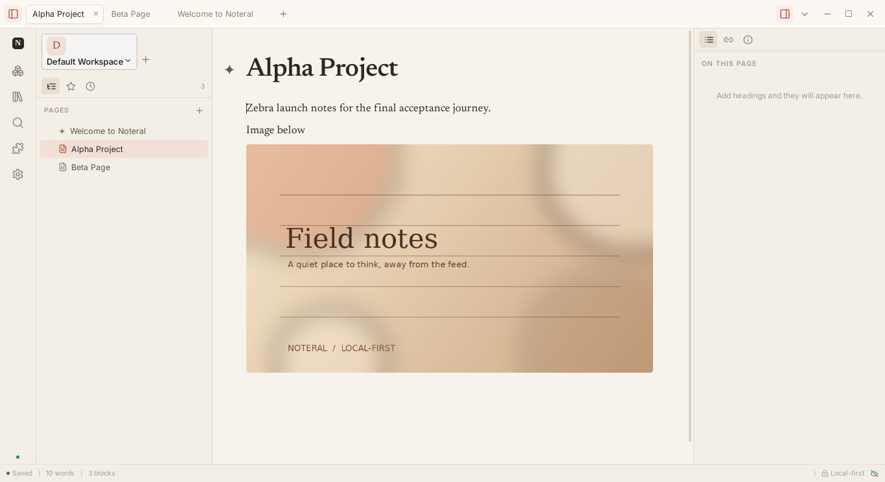

# Noteral

A local-first desktop notes app for people who think in pages. Noteral is built
with **Wails v3**, Go, React 19, TypeScript, and BlockNote. Notes live in a
portable `Data/` folder beside the application: no account, no sync service, no
telemetry, and no CDN at runtime.



## What is here

- Frameless desktop shell with a draggable title bar, tabs, page tree, command
  palette, inspector, status bar, and responsive sidebars.
- BlockNote editor with headings, lists, checklists, quotes, code, tables,
  links, slash commands, drag handles, pasted/dropped images and files, plus
  a full-width writing mode.
- Nested pages, inline rename, drag-to-reorder, duplicate, favorites, recent
  pages, and stable page-ID links with backlinks.
- Page icons and covers: search the bundled Lucide set, browse the full emoji
  catalog with skin tones, upload a local image, and pick icon colors or a cover
  from curated colors, gradients, and offline illustrations.
- Trash with restore, permanent delete, and empty-all, so deleting a page is
  reversible.
- SQLite persistence, per-workspace databases, FTS5 full-text search, autosave
  with confirmed save states, and flush-before-quit.
- Multiple workspaces with their own pages, assets, tabs, and search index.
- Sandboxed plugin system with a versioned TypeScript SDK, permissions,
  commands, status items, read-only inspector panels, settings, and events.
- Two installable examples (**Reading Time**, **Meeting Notes**) and a starter
  plugin template.
- Light, dark, and system themes; local Inter/Newsreader fonts.

The implementation status and known limitations are listed at the end of this
file. The original product brief is in [`docs/goal.md`](docs/goal.md).

## Requirements

| Tool | Version used |
| --- | --- |
| Go | 1.26+ (tested with 1.27.4) |
| Node.js / npm | Node 22+ (tested with 24.18.1 / npm 12) |
| Wails CLI | v3.1.0 |
| Linux native deps | GTK 3, WebKitGTK 4.1, gcc, pkg-config |

Install the Wails CLI:

```sh
go install github.com/wailsapp/wails/v3/cmd/wails3@v3.1.0
# ~/go/bin is usually on PATH; otherwise use $(go env GOPATH)/bin/wails3
```

This checkout targets **Wails v3.1.0**. Wails v3.1's Linux default backend is
GTK4/WebKitGTK 6; the Linux build tasks in this repository force the GTK3
backend because that is what the verified host provides:

```yaml
# build/linux/Taskfile.yml
-tags gtk3              # development
-tags production,gtk3   # production
```

If your machine has GTK4/WebKitGTK 6 and you want to use it, remove `gtk3` from
those build flags and verify the native build again.

## Install dependencies

```sh
npm --prefix frontend install
npm run plugins:build
```

`plugins:build` compiles the SDK payload, both catalog examples, and the starter
example. Re-run it after changing anything under `sdk/` or `examples/`.

## Development

```sh
# Native Wails app + Vite dev server (HMR for the renderer)
wails3 dev -config ./build/config.yml -port 9245
```

`build/linux/Taskfile.yml` builds the Go side with `-tags gtk3`. Vite serves the
renderer at port 9245 and proxies `/__assets` to the small Go asset server on
port 9246 (used only in development). Embedding the production frontend is still
verified by a normal native build.

Useful isolated commands:

```sh
# TypeScript + Vite production build
npm --prefix frontend run build

# Frontend unit tests
npm --prefix frontend test

# Go tests (gtk3 is required on this host)
go test -tags gtk3 ./...

# Production native binary -> bin/noteral
wails3 build

# Run a specific data directory
./bin/noteral --data-dir /tmp/noteral-demo
```

### A clean local run

```sh
rm -rf /tmp/noteral-demo
./bin/noteral --data-dir /tmp/noteral-demo
```

The first launch creates **Default Workspace** and a seeded **Welcome to
Noteral** page exactly once. Move the `Data/` folder while the app is closed to
move the library to another machine.

## Data layout

The root is chosen in this order:

1. `--data-dir <path>` (also accepts `--data-dir=<path>`)
2. `NOTERAL_DATA_DIR` environment variable
3. `Data/` beside the executable (macOS: beside the `.app` bundle)

Startup fails with an explicit error if the directory cannot be created or
written. There is no silent fallback to a home directory or browser storage.

```text
Data/
├── noteral.db                         app registry, settings, plugin state, meta
├── workspaces/
│   └── ws_<id>/
│       ├── workspace.db               pages, links, tabs, FTS5 index
│       └── assets/
│           └── 2026/11/<id>-photo.png relative asset storage
├── plugins/
│   └── com.example.plugin/
│       ├── plugin.json                installed manifest
│       ├── plugin.js                  sandboxed entry point
│       └── settings.json              plugin-owned settings (if used)
└── backups/
    └── 2026-11-21/                    daily VACUUM INTO snapshots, 7 days
```

Asset references are stored relative (`assets/<yyyy>/<mm>/<file>`), never as
absolute paths. The app serves them through a validated `/__assets/<workspace>/`
route.

## Documentation

- [Plugin SDK and plugin guide](docs/PLUGIN_SDK.md)
- [Architecture and persistence](docs/ARCHITECTURE.md)
- [Testing and verification](docs/TESTING.md)
- [Original product brief](docs/goal.md)
- [Starter plugin](examples/starter/README.md)

## Verified on this machine

Linux (Debian 13, X11, GTK 3.24, WebKitGTK 4.1) was tested with a native Wails
build and an end-to-end UI/DB journey: first launch, typing, autosave, image
paste, page links, workspace creation/switching, full-text search, plugin
install/enable/disable, and close/reopen with flushed content.

Run the exact commands and see the recorded results in
[`docs/TESTING.md`](docs/TESTING.md).

## Known limitations

- **macOS and Windows were not built or run here.** The Wails window code keeps
  native macOS traffic lights with the hidden-inset title bar, and uses custom
  controls on Linux/Windows, but only Linux was verified. Packaging (`.app`,
  `.msi`, `.deb`) was not exercised.
- **Linux requires GTK3/WebKitGTK 4.1** for the verified build. The forced
  `gtk3` tag is intentional; see the requirements section.
- **Plugin panels are read-only plain text.** Plugins cannot render arbitrary
  HTML/React into the privileged renderer. Commands, status items, panels,
  settings, document reads/writes, search, tabs, and navigation go through the
  permission-checked host boundary.
- **Remote catalogs are fetch-only.** Noteral never contacts the network on its
  own; fetching a catalog URL is an explicit action and remote entries are
  installed separately.
- **No sync, collaboration, mobile, or auto-update.**
- **Search is deliberately simple.** FTS5 prefix terms and title matching; no
  boolean/advanced query syntax.
- **Markdown export is readable but lossy for custom/unknown blocks.** JSON
  export is the lossless format.
- **No native application menu bar** is rendered; primary actions use the
  command system (titlebar menu, shortcuts, palette, plugin commands).
- Window resizing/dragging on Linux relies on the window manager; the verified
  X11 session supports both.
